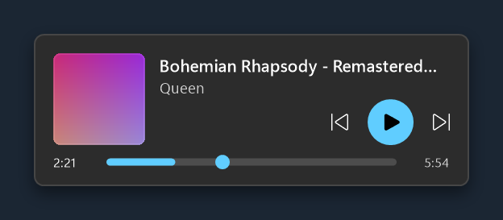
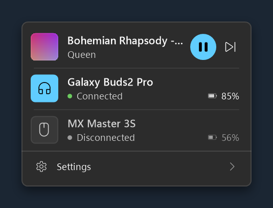
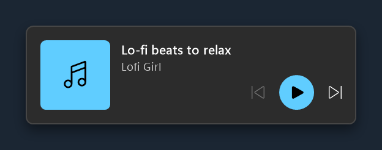
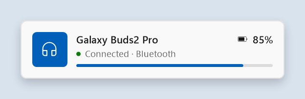
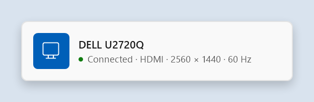
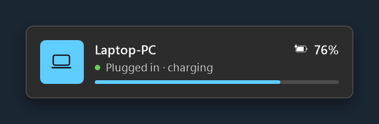

# Hublot

**Fluent popups for Windows** — a lightweight “visual PowerToys”: small Windows 11-style cards for your
wireless devices, the music you're playing, USB drives, displays and battery. Every module can be turned
on or off.

*Version française : [LISEZMOI.md](LISEZMOI.md).*

<p>
  
  
</p>

## Modules

| Module | What it shows |
|---|---|
| **Wireless devices** | Name, state and battery of Bluetooth devices, Logitech receivers (Unifying, Bolt, Lightspeed) and Xbox controllers when they connect or disconnect; low battery, charging and charge-level alerts. |
| **Now playing** | Cover, title and artist on every new track, with previous / play-pause / next, a clickable progress bar, colors taken from the album art and an optional always-on mini player. By default only the major music platforms (Spotify, Deezer, Apple Music, YouTube Music…) trigger it. |
| **USB devices** | Name and state of USB devices; free and used space for drives. |
| **Displays** | Real name, connection (HDMI, DisplayPort, VGA, USB-C…) and resolution of a display when it is plugged in or unplugged. |
| **Power** | PC name and battery level when a laptop is plugged in or unplugged, charge-level and low-battery alerts. |

<p>
  
  
  
  
</p>

Hovering the tray icon shows every connected device and what's playing in a single card. Popups follow
the Windows light / dark mode and accent color, with Acrylic or Mica materials on Windows 11.

## Install

1. Download **`Hublot-Setup.exe`** from the [latest release](../../releases/latest).
2. Run it and click *Install* — per-user install, no administrator rights.

Windows SmartScreen may warn you because the installer isn't signed yet: click *More info* › *Run anyway*.
Hublot then checks for new versions on GitHub once a day (can be turned off in *Settings › About*).
Uninstall from *Windows Settings › Apps › Installed apps*.

Requires Windows 10 version 2004 or later; Acrylic and Mica need Windows 11 22H2 or later.
The interface is in English or French (Windows language, or chosen in *Settings › General*).

## Lightweight by design

- A single background process with no polling: Hublot waits for Windows notifications and only draws
  during animations — about 3 to 5 MB of memory when idle.
- Native Win32 rendering (GDI+ and the Windows compositor), no web engine.
- No data collected. The only network access is the daily update check against this repository's releases.

## Build from source

Requires the [.NET 10 SDK](https://dotnet.microsoft.com/download).

```powershell
.\build.ps1                 # dist\Hublot-Setup.exe
.\build-store.ps1           # dist\Hublot-<version>.msix (Microsoft Store package, needs the Windows SDK)
dotnet build src\Hublot     # background service (Win32, trimmed)
dotnet build src\Hublot.Core  # settings window and installer (WPF)
```

All interface texts, in French and English, live in [`src/Hublot/Common/Strings.cs`](src/Hublot/Common/Strings.cs).
Architecture notes (in French): [CLAUDE.md](CLAUDE.md).

**Release:** set the same `<Version>` in both `.csproj` files, then push a matching tag (`git tag v3.1.0 && git push --tags`):
GitHub Actions builds `Hublot-Setup.exe` and attaches it to the release.

## License

[MIT](LICENSE)
